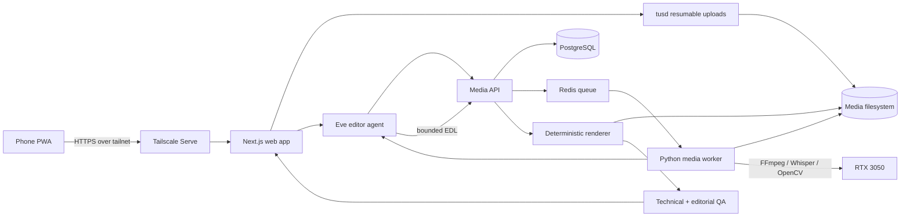

# Agent-directed media server plan

Status: accepted architecture; implementation tracked in `docs/build-phases.md`
Prepared: 2026-10-20

This document preserves the original architecture decisions and inventory at that date. For the implemented system, current limitations and proposed changes, read the [26 October system audit](system-audit-and-roadmap.md) and [build status](build-phases.md). Historical statements such as an empty repository describe the initial inventory, not the current application.

## 1. Goal and operating rule

The server should accept original videos and photographs from a phone, create short-form video and designed social posts, and return reviewable exports. Agents make editorial decisions; deterministic media tools perform the edit.

The system must enforce this provenance rule:

> Published pixels and audio may come only from uploaded source media, approved brand assets, approved fonts, and an approved music/SFX library. Models may analyze, select, sequence, crop, grade, caption, and place those assets. No image, video, voice, or music generation tool is available to an agent.

AI-written captions, headlines, and post copy should be a separate per-project switch. In strict mode, text must be supplied by the user or quoted from the source transcript.

## 2. Server audit

The project repository is empty, so there is no application architecture to preserve.

| Area | Observed state | Implication |
|---|---|---|
| OS | Ubuntu 26.04.1 LTS, kernel 7.0.0-38, Secure Boot enabled | Suitable base; pin container versions and keep host changes small. |
| CPU/RAM | Intel i7-11370H, 4 cores/8 threads, 14 GiB RAM, 4 GiB swap | Good for one active render or analysis job. Concurrency must be limited. |
| GPU | RTX 3050 Mobile, 4 GiB VRAM, driver 595.99.02, CUDA 13.2 visible | Useful for NVENC/NVDEC and one modest transcription/vision workload. Too small for a strong local multimodal LLM alongside rendering. |
| Storage | One 1 TB NVMe; 885 GiB root filesystem, about 829 GiB free | Enough for an MVP working set, but it is one failure domain and not an archive. Add backup/storage before relying on it for originals. |
| Containers | Docker 29.1.3, Compose 2.40.3, NVIDIA Container Toolkit 1.20.1; Docker service active | Base is present. GPU passthrough still needs an actual container test. The `gm` login currently has no Docker socket access. |
| Media tools | FFmpeg/ffprobe absent on host | Put pinned builds in worker containers rather than depending on host packages. |
| Network | Tailscale 1.104.1 active; only SSH is listening publicly on TCP | Keep the application on loopback and expose it privately with Tailscale Serve. Do not use Funnel. |
| SSH/security | Key authentication on, password and root login off; UFW default inbound policy is DROP; unattended upgrades enabled | Good baseline. Confirm the effective UFW rules and restrict SSH to `tailscale0` or the LAN if direct LAN SSH is required. |
| Hardware health | Normal idle temperatures. Current boot contains an Intel i915 warning and one correctable NVMe PCIe Rx error | Monitor recurrence. Run NVMe SMART diagnostics before putting unique footage on the disk. |
| Appliance behavior | Lid-close actions are ignored | Appropriate for laptop hardware used as an always-on server. Confirm suspend/hibernate targets and auto-start after power loss. |

Inspection limits: this session did not have sudo and could not read effective UFW rules, run NVMe SMART, or access the Docker socket. Those checks belong in Phase 0.

## 3. Recommended architecture



Use a small number of clear services in Docker Compose:

| Service | Responsibility |
|---|---|
| `web-agent` | Next.js mobile UI and Eve agent runtime. Holds the conversation/brief, calls typed tools, presents progress and approvals. |
| `api` | FastAPI service for projects, assets, jobs, edit decision lists, approvals, and signed/authorized downloads. It is the authority for job state. |
| `tusd` | Chunked, resumable uploads directly to the media volume. A completion hook registers the asset with the API. |
| `postgres` | Job metadata, agent decisions, event log, templates, provenance, and audit history. |
| `redis` | Low-overhead work queue and short-lived progress events. PostgreSQL remains the source of truth. |
| `worker` | Python analysis and rendering tasks. It receives the GPU and mounts only the media paths it needs. |

Eve is a good fit for the conversational editor because it provides durable sessions, typed tools, approvals, and self-hosted Postgres-backed execution. Long media operations should still be jobs owned by the media API; the agent starts them and waits for events rather than holding an LLM call open for hours.

Do not give an agent shell access, arbitrary filesystem paths, arbitrary FFmpeg arguments, or a general HTTP client. Its tools should be narrow operations such as `inspect_assets(job_id)`, `submit_edit_plan(job_id, edl)`, `request_preview(job_id)`, and `approve_export(job_id)`.

## 4. Editing workflow

Each job moves through explicit, resumable states:

1. **Upload** — the phone creates a project and resumably uploads assets. Each completed file gets a SHA-256 digest; the original becomes read-only to application workers.
2. **Ingest** — ffprobe validates codecs, duration, orientation, frame rate, audio layout, and timestamps. The worker rejects corrupt or unsupported input and creates edit-friendly proxies.
3. **Analyze** — local tools create a timestamped transcript, scene boundaries, silence/audio levels, face/object tracks, blur/quality scores, thumbnails, and contact sheets. These are observations, not edits.
4. **Brief** — the user chooses platform, target duration, aspect ratio, message, CTA, tone, brand kit, and whether AI-written copy is allowed.
5. **Plan** — the editor agent receives the brief plus structured observations and low-resolution frame samples. It returns a schema-validated edit decision list (EDL) referencing only source asset IDs and time ranges.
6. **Preview** — the renderer produces a watermarked low-resolution preview. The user can approve it or say things such as “make it tighter” or “use more of clip 3.” Revisions create a new EDL version.
7. **Render** — FFmpeg performs cuts, speed changes, audio normalization, color presets, reframing, and captions. Remotion renders approved motion/layout templates where HTML/CSS typography is useful. Both consume the validated EDL.
8. **QA** — deterministic checks verify duration, resolution, loudness, black frames, clipped captions, safe areas, file size, and codec. A separate reviewer agent may compare the preview with the brief and request at most two bounded revisions.
9. **Deliver** — the app shows the reel, cover image, post images, caption text (if enabled), and a provenance manifest. The user downloads or shares them. Publishing to social networks is a later, separately authorized feature.

The EDL should be a versioned JSON schema. A typical reel plan contains source asset IDs, in/out timecodes, ordering, crop keyframes, transcript-derived caption segments, transition IDs, grade preset, audio mix, template ID, and target export profile. It must never contain raw shell commands.

## 5. Media implementation

Use the GPU where it has clear value and keep a CPU fallback:

- FFmpeg with NVDEC/NVENC for proxies and H.264/H.265 delivery exports.
- `faster-whisper` with an int8 model sized to remain inside 4 GiB VRAM. Benchmark `medium` and a distilled/turbo variant on real clips before choosing the default.
- PySceneDetect/OpenCV for shot boundaries and image quality metrics.
- A face/subject detector for 9:16 reframing. Store tracking boxes as metadata; FFmpeg applies the actual crop.
- EBU R128 loudness analysis/normalization and limiter rules for audio.
- WebVTT/SRT as the caption source of truth, with ASS or Remotion used only for final styling.
- Remotion templates for animated titles, lower thirds, end cards, carousels, and still posts. Templates are designed and versioned by a human; the agent selects one and fills constrained fields.

Start with three polished, narrow recipes rather than “edit anything”:

1. Talking-head reel: 15–60 seconds, 9:16, transcript-led cuts, tracked crop, burned captions, intro/end card.
2. Event/product montage: best-shot selection, beat-aware cuts using licensed music, branded end card, 15/30-second variants.
3. Photo post/carousel: source photo crop, one of several brand layouts, supplied or approved text, export at platform presets.

## 6. Model and privacy strategy

Use the RTX 3050 for media processing. The primary editorial brain is the owner's ChatGPT Pro plan connected with Sign in with ChatGPT and called directly from the private worker. The initial model is `gpt-6.1-sol`. Vercel AI Gateway remains an optional, environment-configurable fallback, but it is disabled by default so the system cannot silently begin API spending when plan usage is unavailable. It runs only after `AI_GATEWAY_FALLBACK_ENABLED=true` is deliberately configured with a key and budget controls.

Local faster-whisper remains responsible for transcription. It is a deterministic analysis dependency rather than the editorial language model, avoids per-minute transcription charges, and keeps full-resolution audio on the server. No separate local editorial LLM is planned for the first version.

The ChatGPT credential is stored in a dedicated Docker volume mounted only into the enrollment helper and media worker. Direct plan requests set `store: false`, stream Responses API output, and request a strict JSON schema. Eve remains the conversational, typed-tool surface, while the durable worker performs automated planning because subscription-backed ChatGPT credentials cannot be embedded in a deployed Eve model provider.

Raw media remains local. The normal cloud-agent payload should contain the brief, transcript, technical metadata, and selected low-resolution thumbnails/contact sheets. This still sends visual and transcript content to the configured model provider, so provide a per-project privacy mode:

- **Hybrid quality mode:** hosted model sees transcript and selected thumbnails; originals never leave the server.
- **Text-only cloud mode:** hosted model sees transcript/metadata but no images; local detectors supply visual facts.
- **Local-only mode:** no material leaves the server; initially use fixed recipes and user review because local reasoning quality will be limited on this GPU.

Record which mode and model produced every EDL. Model output is untrusted input: validate it against the schema, asset inventory, maximum duration, and allowed effects before enqueueing a render.

## 7. Phone experience

Build the submission UI as an installable PWA served only inside the tailnet:

1. Open `https://gm-server.<tailnet>.ts.net` on the phone and install it to the home screen.
2. Tap **New job**, choose a saved recipe, enter a one-sentence brief, and select videos/photos from the phone.
3. The app uploads through tus in chunks, shows per-file progress, and resumes interrupted transfers.
4. The dashboard shows `uploading → analyzing → draft ready → rendering → complete` and provides a lightweight preview.
5. The user approves or requests a revision in the same job thread, then downloads the final package.

On iOS, a browser/PWA can be suspended while the screen is locked. Resumability prevents starting over, but reliable multi-gigabyte background transfer eventually warrants a small native share extension/app using the same API. Build that only after the workflow proves useful. On the same Wi-Fi, Tailscale should normally form a direct local connection, so footage does not need to relay through a public upload service.

Use Tailscale Serve for HTTPS and tailnet identity headers. Bind the web service to `127.0.0.1`; accept identity headers only from that loopback proxy. Add an application session and CSRF protection as defense in depth. Keep Tailscale Funnel disabled.

## 8. Storage and retention

Use a simple filesystem layout on a dedicated media root:

```text
/srv/media/
  originals/<project>/<asset-id>/
  proxies/<project>/
  analysis/<project>/
  previews/<job>/<edl-version>/
  exports/<job>/<edl-version>/
  templates/<template-version>/
  quarantine/
```

The application should never trust uploaded filenames as paths. Originals are immutable and content-addressed in metadata. Temporary files are written beside their destination and atomically renamed after successful completion.

The current upload lifecycle is: tus writes resumable chunks into the persistent `upload-data` staging volume; the worker verifies the completed size, copies the bytes into the persistent `media-data` volume at `/media/originals/<project>/<asset-id>/source`, calculates SHA-256, atomically installs the read-only original, removes the staging upload, and queues local analysis. Proxies, thumbnails, contact sheets, transcripts, previews, and deliveries live separately in `media-data`, so rendering never modifies the original. PostgreSQL stores the searchable ownership, job attachment, status, and hash records in its own persistent volume.

The reusable library adds a source-derived catalogue beside those ownership records. The worker indexes Whisper utterances, FFmpeg scene boundaries, filenames, media facts, exact asset IDs, and source time ranges into PostgreSQL full-text search. Each segment records its evidence producer and catalogue version. A private local CLIP service also embeds representative source frames and text queries, allowing semantic visual search without sending images to a hosted provider. Every vector records its pinned model revision and exact source frame/time range; the interface shows that frame instead of inventing a textual description. Reviewed SHA-256 duplicate groups resolve to one canonical text and visual index during search, while a changed group becomes unreviewed again. OCR and hosted visual descriptions remain separate future enrichments with explicit privacy, cost, and re-index controls.

Phase 6C adds a logical content library over those originals. Jobs will attach references to existing library assets rather than copying files. Because the present `assets.project_id` relationship owns deletion, cross-project reuse requires separating library ownership from project/job attachment first; this prevents one old project deletion from unexpectedly removing footage used by another job.

Keep at least 15% of the NVMe free. Default retention proposal: proxies 14 days after final approval, previews 30 days, exports 90 days, originals until explicitly archived or deleted. Show the expected space recovery before deletion.

Before real use, add a second copy of originals and final exports. The minimum is a large external drive with nightly restic backups and periodic restore tests. A NAS or encrypted object-storage backup is better. The database and brand/template library also need backup. RAID alone would not replace this backup.

## 9. Security and operational controls

- Expose only the Tailscale Serve endpoint. Containers bind application ports to loopback or an internal Docker network.
- Run every container as a non-root UID, read-only root filesystem where practical, `no-new-privileges`, dropped capabilities, resource limits, and pinned image digests.
- Give the worker read-only access to originals and write access only to derived-media directories.
- Store API/model keys as Docker secrets or root-readable environment files outside Git. Never include secrets in agent context or logs.
- Reject unexpected MIME/codec combinations, cap file and project size, sanitize metadata, and quarantine failed inputs.
- Permit one GPU-heavy task at a time on this hardware. Reserve memory/CPU for SSH, Tailscale, PostgreSQL, and the web UI.
- Persist structured logs and job events. Add health checks for disk space, temperature, SMART status, queue depth, failed jobs, and backup age.
- Require explicit user approval before final delivery in the MVP. Require a separate approval before any future external publish action.

## 10. Delivery phases

### Phase 0 — host readiness (about half a day)

- Verify UFW rules and limit SSH exposure.
- Decide how deployment gets Docker access. Membership in the Docker group is effectively root access; a root-managed systemd/Compose deployment is safer for a hardened appliance.
- Run `docker run --rm --gpus all ... nvidia-smi` and a short NVENC test.
- Run NVMe SMART self-tests and review the i915/NVMe warnings after another boot.
- Confirm wired Ethernet speed, suspend/hibernate behavior, thermal behavior under a 20-minute encode, and boot-time service startup.
- Create the media volume layout and backup target.

Exit criterion: a reboot returns Docker, GPU access, Tailscale, backups, and the deployment service to a healthy state without manual login.

### Phase 1 — vertical slice (about 3–5 focused days)

- Compose stack with Postgres, Redis, tusd, API, web/agent, and one GPU worker.
- PWA project form and resumable upload.
- Ingest, ffprobe, proxy generation, transcription, scene thumbnails.
- One talking-head recipe and one human-designed caption/end-card template.
- Agent creates a schema-valid EDL; worker renders a preview; phone can approve and download a 1080×1920 H.264 export.
- Provenance manifest and durable restart/retry behavior.

Exit criterion: upload a real phone clip, lock the phone once during upload, resume, receive a coherent preview, request one revision, reboot during processing, resume the job, and download a valid final reel.

### Phase 2 — quality and design system (about 1–2 weeks)

- Brand kits, fonts, palettes, logos, safe-area guides, and versioned Remotion templates.
- Subject tracking/reframing, audio cleanup, caption correction UI, music library, still/carousel recipe.
- Editorial reviewer, bounded retries, before/after comparisons, and golden-project evaluations.
- Storage quotas, retention UI, backup/restore drill, monitoring, and mobile notifications.

Exit criterion: a fixed evaluation set consistently meets technical checks and a written editorial rubric without manual timeline editing for the supported recipes.

### Phase 3 — convenience and scale

- Native mobile uploader/share extension if PWA background behavior is too limiting.
- More recipe/template packs based on actual jobs.
- Batch variants for multiple platforms.
- Optional NAS/object storage and a stronger GPU if local-only multimodal editing or parallel work becomes important.
- Optional social publishing connectors with per-post approval and platform-specific credentials.

## 11. What to decide before implementation

These choices change product behavior but do not block the technical skeleton:

1. Does “no AI-generated content” prohibit generated post copy too, or only synthetic image/video/audio?
2. May a hosted model receive transcripts and small frame samples, or must all media-derived data stay local?
3. Which phone platform matters first: iPhone, Android, or both?
4. Which first recipe is most valuable, and what examples define a good result?
5. Where will the second copy of original footage live?

The recommended starting choices are: prohibit synthetic media but allow opt-in draft copy; use hybrid quality mode; build the PWA for both phone platforms; start with talking-head reels; and back up originals to a dedicated external drive immediately.

## 12. First implementation milestone

Do not begin with a general-purpose autonomous studio. Build the talking-head vertical slice end to end and measure it on ten representative clips. The output should include:

- `reel.mp4`
- `cover.jpg`
- `captions.srt`
- `post-copy.txt` only when AI-written copy is enabled
- `manifest.json` containing source hashes, EDL version, tool/model versions, template version, render settings, and QA results

This milestone proves upload reliability, editorial control, GPU performance, rendering quality, provenance, and phone usability before adding more agents or templates.
