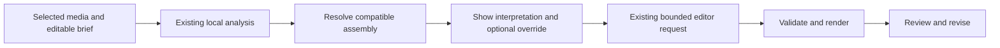

# Brief first editing and recipe simplification plan

Updated: 2026-10-26 (Australia/Brisbane).

The main job form should ask what the user wants to make, not require them to choose a rendering engine. A brief such as “Make a gentle, feel-good product montage; keep the spoken explanation and show the cream close-ups” combines purpose, mood and visual direction. Those instructions should work together rather than compete as exclusive recipes.

This plan records the recommended change before modifying application behaviour. It preserves the successful existing model, source-analysis settings and render path during the first increment. The current human acceptance checks are in the [hands-on checklist](user-acceptance-checklist.md).

## Current source findings

- Jobs store one of two rendering recipes: `talking_head` or `montage`. The main form now labels them Speech-led reel and Montage.
- These are different plan schemas, not cosmetic labels. Speech-led plans require source video/audio; montage plans permit image clips and carry different clip-duration/count/audio rules.
- Both engines already support picture-only B-roll and local finishing. The practical creative boundary is less clear than the initial two-card choice suggests.
- The form currently rejects a speech-led job when its brief contains the word “montage”, even if it merely asks for montage-style cutaways or says not to make a montage.
- Recipe selection changes duration choices and can be overwritten by a saved profile. Selected library concepts explicitly create speech-led jobs.
- Editorial purpose is now separate: `auto`, `story`, `promotion` or `bloopers`. Blooper policy has dedicated evidence, learning and review behaviour. That separation must survive the form change.

## Recommended form

1. **Choose media.** Preserve mixed server/device selection and the existing upload/readiness flow.
2. **Describe the edit.** One prominent editable brief, with examples or optional shortcuts such as Product story, Bloopers, Feel-good montage and Suggest something. Shortcuts insert visible direction; they do not submit or start editing.
3. **Adjust presentation if needed.** Keep useful music, effects, caption/platform, approximate length and saved presentation preferences available. Avoid making every setting mandatory.
4. **Inspect the interpretation when ready.** After source analysis, show the intended assembly and a short reason, for example “Continuous speech with supporting product pictures.” Provide an Advanced override before planning begins.

An interpretation is not a claim that the system verified a scene or found a good story. Missing speech, uncertain footage or an unsupported request must remain visible.

## How instructions should interact

| Input | Responsibility |
| --- | --- |
| Brief | Desired result, purpose, story, feeling, pacing and exclusions. It is the main user instruction. |
| Optional visible controls | Explicit music/effect/privacy/platform choices and deliberate technical overrides. Conflicts with the brief must be surfaced rather than silently resolved by a hidden preset. |
| Selected library concept | Cited recorded material and the chosen story/outtake intent. Preserve source meaning and allow an explicit subsequent revision. |
| Source analysis and library metadata | Evidence about usable speech, images and possible cutaways; filenames/OCR/tags are not instructions. |
| Saved profile | Presentation defaults. It must not quietly turn a blooper into an ad or override an explicit assembly choice. |
| Automatic assembly | A compatible technical path, not a new story purpose, sales requirement or duration quota. |

Ad, montage and slow/feel-good are not interchangeable categories. Ad describes a purpose; montage describes a visual approach; slow/feel-good describes presentation. Product footage alone must not imply a request for an ad. Bloopers must require explicit direction or a selected blooper concept, never an effects level or a funny tone.

## First implementation increment

### Make automatic assembly the default

Introduce an automatic selection mode while retaining an explicit Speech-led/Montage override in Advanced. Store the requested mode separately from the resolved engine. Resolve once source analysis is ready, before the first planning request, and persist the choice/reason for inspection and retry consistency.

Use the existing brief and analysis rather than adding a paid classification request. Do not use the presence of one word as a universal routing rule. Compatibility facts and explicit unambiguous instructions take precedence over a guess; ambiguous mixed footage can use the existing speech path when continuous recorded dialogue is central.

Representative routing cases:

| Brief and sources | Intended handling |
| --- | --- |
| A complete recorded explanation plus silent close-ups and a review image | Preserve a speech spine and layer relevant cutaways. |
| A music-led sequence of photos and silent scenes | Use the montage-capable assembly path. |
| A recorded stumble with its genuine reaction | Use a compatible speech path with blooper policy; no sales ending or compulsory pacing effects. |
| “Use montage-style cutaways, but keep my whole explanation” | Preserve the explanation; do not route solely because “montage” appears. |
| “Do not make an ad” with product footage | Do not infer promotion from the product, source filename or old project title. |
| Insufficient usable media for the requested result | Explain the missing material or offer a supported narrower approach; do not duplicate filler to satisfy an engine rule. |

Single stills, independent audio sources and unusually long montage speech passages expose existing engine limits. The first increment must handle or clearly report these compatibility cases. Hiding the selector alone does not remove those limits.

### Keep purpose clear without duplicating the brief

Make Follow my brief the normal entry. Optional shortcuts should leave their effect visible and editable. Reuse the current purpose field for deliberate advanced choices and selected concepts, with the resolved purpose visible in review. A direct conflict between explicit purpose and brief should be clarified in the form, not sent as competing instructions.

The first increment should use conservative inference for conventional requests. Mood should not be silently changed by source type or profile. Complex natural-language direction still belongs to the existing editorial request; a small local router is not a general language-understanding model.

### Preserve working edits

Do not migrate existing frozen plans, reinterpret old approvals or re-render earlier jobs. Retain their schema/engine and exact-render behaviour. New jobs default to automatic mode; saved profiles retain their existing presentation values, while any inherited format is visible rather than a hidden lock-in. Revisions preserve the current compatible engine unless an explicit rebuild requires and supports a different one.

Keep music/rights, source bounds, privacy, no-invented-media, effect limits and stale-version validation. Do not change the default editor model, reasoning effort or transcription quality as part of this form change.

## Second implementation increment

After paired playback checks show the first increment preserves quality, converge the internal plans toward shared picture/audio tracks, source ranges, layers and caption timing. Move arbitrary stylistic quotas out of validators; retain actual safety/compatibility bounds. This is a separate renderer/schema change with its own legacy-plan tests, rather than an immediate rewrite hidden inside the form update.

The goal is for a reel to combine sustained dialogue, a music-led passage, photos and silent cutaways where the brief supports them. Public recipe categories should not multiply to represent every combination.

## Acceptance before release

- The main form can be completed without selecting a technical recipe.
- Brief shortcuts and setting changes never auto-submit, upload or start a model request.
- Automatic routing makes no extra classification request and does not increase the existing context budget.
- A known successful ordinary speech edit retains the current planning path; compare real output quality rather than expecting identical hosted-model output.
- Image/video montage inputs reach a compatible renderer, including clear handling of insufficient media.
- Explicit negative instructions, bloopers, slow/warm direction and mixed speech/B-roll briefs are covered by routing/prompt tests.
- Saved profiles and library concepts cannot silently overwrite the explicit purpose or override.
- The selected assembly and reason are inspectable; retries do not randomly choose another engine.
- Previous plans, local finishing, exports, variants and exact re-renders remain compatible.
- Phone, keyboard, source switching, resume, stale-tab, failed-request and no-duplicate-job interactions pass.
- Paired human tests cover an ad, a non-ad explanation, a slow montage, mixed dialogue/B-roll and actual bloopers.

Application behaviour remains unchanged while this proposal is reviewed. Documentation and test preparation can proceed independently.
