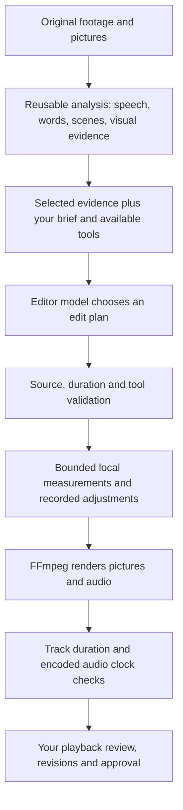

# How GM Studio decides what to edit

This describes the editing-contract and audio-timing repair increment. Source implementation and regression tests are separate from deployment and human playback acceptance.

## The short explanation

GM Studio analyses your originals once and reuses that analysis. The editor receives your brief, selected source evidence, recorded speech with timestamps, small permitted picture previews, available tools and approved creative assets. It returns an edit plan: which real source ranges to use, their order, and any picture, audio, caption or effects treatment. Local software validates and renders that plan. It does not generate replacement speech.

The system can make one bounded corrective model request if a generated plan fails validation. There is no unlimited critique loop. Explicit local controls and exact re-renders reuse the saved plan and require no editor-model request.

## Hard rules and creative guidance

Hard rules protect real sources, supported time ranges, complete required speech, duration limits, bounded tool settings and reviewed music/effect permissions. The technical renderer must produce full video and audio tracks with valid internal audio timestamps. It must not replace a usable file with an invalid render.

Creative guidance describes what might make the reel effective. A hook, payoff or story-role label helps organise the material; it is not an obligation to turn every video into an advertisement. A family outing can be an exchange or experience. A product ad needs its supported product explanation. A blooper needs an understandable recorded mistake and reaction, not a sales checklist. Automatic clues about humour, repeated takes and speech gaps can be wrong.

The instruction order is now explicit:

1. Preserve the recorded meaning and follow the user's brief.
2. Keep audible, understandable passages and their necessary connections.
3. Build the requested story or experience.
4. Apply optional creative treatment where it helps.

We removed two old style requirements: a minimum visual emphasis on energetic edits and a compulsory transition on longer energetic edits. Local repair no longer inserts a rhythmic zoom or transition just to satisfy those requirements. High impact still suggests purposeful picture or sound changes around useful moments; it does not require cutting the speaker every few seconds.

## Audio pacing and picture pacing

These are separate decisions. A picture can cut to B-roll or zoom while the original dialogue continues unchanged.

| Audio direction | When it applies | Guidance |
| --- | --- | --- |
| Connected passages | Ordinary stories and conversations | Keep enough lead-in, response and natural sound for exchanges to make sense. |
| Tighter dialogue | Promotional explanations or explicit requests to tighten pauses | Remove disposable waiting while retaining complete words and connecting phrases. |
| Music led | Explicit visual/musical assembly without a speech-preservation request | Use speech as complete passages where useful, rather than scattered fragments. |

An explicit request to preserve dialogue, conversations or natural sound protects those passages from automatic local pause trimming. Manual pause controls remain available. Ordinary local pause cleanup otherwise requires both a word gap and a measured quiet interval; a gap between transcript words alone does not establish silence. Cleanup is bounded and can decline to change a clip if evidence or time is insufficient.

Useful briefs include “Keep the conversation and natural sound; add playful picture changes,” “Make a tight product explanation without cutting off words,” or “Make a warm visual montage, with only a few complete spoken moments.” They should guide style, not compensate for technical faults.

## What happens locally after planning

Local stages can repair predictable metadata/default conflicts, tighten clearly measured disposable waiting, balance measured voice levels and apply conservative compression or eligible noise reduction. Manual choices and saved plans take precedence where applicable. These stages are not another creative model and cannot establish that a joke or story works.

New previews record a **How this edit was made** panel: the planning route, recorded audio direction, local plan changes and source-level audio processing counts. An exact re-render is labelled as a saved-plan render. Older planning decisions are not retroactively claimed to have followed the new contract. Existing treatment and revision reports provide more detailed tool and before/after information.

## The recent audio fault

A still JPEG stored without a filename extension was automatically probed as a JPEG stream. Embedded image data triggered decoder errors and a change of picture properties. FFmpeg reinitialised the shared processing graph, resetting the audio clock even though the finished file reported the expected overall duration. The same bytes read as one still image reproduced cleanly.

The repair explicitly uses literal still-image input handling with a recognised decoder for common image formats. It applies to B-roll, picture layers, stickers/meme images and montage stills. GIFs retain their animation demuxer. Originals are not renamed, overwritten or recompressed, and PNG transparency remains available.

The output also has one shared 48 kHz sample-clock boundary after optional loudness, music and effects processing. This addresses a separate measured clock gap on the newer FFmpeg test runtime. A new packet-level check catches compressed, stretched or discontinuous AAC timestamps, including faults hidden by matching track durations. These are technical checks; they do not prove that the chosen speech is coherent or funny.

## What is finished, and what still needs acceptance

The major editing tools through the Phase 28 increments, library work through Phase 29, playback comparison features in Phase 30 and private release acceptance tooling in Phase 31 are implemented in source. These are not equivalent to every feature passing real-user acceptance. Public customer isolation, live publishing/account checks and applicable pilot/restore observations remain separate work.

This increment is stabilisation and rule simplification. It adds no default model upgrade, fine-tuning, automatic lesson promotion, whole-library reanalysis or extra critique calls.

After deployment, first re-render the affected reel using its saved cut. Compare the beginning, every source join, the image cutaway and the downloaded export. That isolates the renderer repair. Then try one fresh conversational story and one product explanation to evaluate the revised planning guidance. Exact re-rendering preserves earlier choices; it does not regenerate a story under new instructions. Passing automated tests cannot guarantee every future model selection, word boundary or joke.

## Validation for this increment

Both the Ubuntu 22.04 FFmpeg 4.4.2 runtime and the newer FFmpeg 8.0.1 runtime completed 784 backend tests: 783 passed and one optional rclone integration test skipped on each. Tests include real CPU renders, mixed frame rates and fractional speech cuts, cleanup/music/effect combinations, literal still-image handling, preserved speech pulses after overlays, and refusal to replace a usable render with invalid audio timestamps. All 110 web interaction tests, TypeScript checks, the production web build, Compose configuration and release audit passed.

The affected real-footage cut was reproduced locally with its original sources, music, sound effect and extensionless image. Literal image input removed the decoder/clock-reset reproduction, and the final pipeline passed the packet check. Repair build `e3c3f147` was then deployed. The live worker rebuilt the affected saved cut as version 2 using NVENC, with an unchanged plan fingerprint, verified track/packet timing and no audio timestamp warnings during decoding. The previous version remains available. No hosted model call was made for this investigation or rebuild. Natural conversation, story quality and downloaded-phone playback still need owner acceptance.
