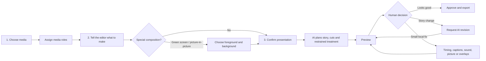

# Effects, transitions and composition audit

## Implementation status — 2026-11-17

- Completed: strict AI schemas now expose every typed/rendered transition, including `cross_dissolve`.
- Completed: the editor prompt no longer claims that AI can configure human-only picture-layer tools.
- Completed: Create now offers Automatic, Standard and Green screen composition alongside media selection.
- Completed: Green screen accepts a presenter and background from device uploads, the Library or both, validates those roles before editing, constrains the edit plan to the presenter source, and applies the chosen background in preview and final rendering before captions and optional treatments.
- Completed: the review page now exposes a composition receipt and job-level green/blue/custom key controls for similarity, edge softness and spill suppression; applying them creates a saved local preview without replanning the story.
- Completed: local finishing begins with Story & timing, Picture, Layers & graphics, and Sound & captions task groups while retaining every existing advanced control.
- Completed: the green-screen review can pause the current preview and sample a bounded colour patch directly from the frame before an explicit local preview request.
- Completed: review now includes a direct per-boundary transition editor and a read-only Edit map for inspecting story, picture, layer, sound and caption treatments before opening the matching local tool.
- Next: deploy migration 050, run the live API/database/worker suite and capture renderer golden files for representative difficult screens and each transition/effect family.

Status: implemented source checkpoint with live deployment and renderer acceptance still pending.

This document separates four things the current interface often calls “effects”:

1. edit treatment — cuts, dissolves, reframing and camera motion;
2. story support — B-roll and picture cutaways;
3. decorative treatment — sounds, stickers, callouts and native visual beats;
4. composition — picture-in-picture, green/blue screen and a chosen background.

They have different inputs, validation rules and ideal points in the workflow. They should not be presented as one setting.

## Recommended user journey



The user should make only decisions that change the meaning, required source material or delivery format before generation. The AI should choose ordinary cuts and optional treatments within a visible envelope. The review page should expose only corrections that are useful after playback.

## What belongs where

| Capability | Start of job | AI may decide | After preview | Admin/library |
| --- | --- | --- | --- | --- |
| Script, dot points or scene order | Required input; preserve exactly when supplied | Timing and supported source matching only | Story revision | — |
| Platform, aspect and maximum duration | Yes | May suggest from an unambiguous brief, never silently override | Delivery variant | Presets |
| Talking footage vs B-roll | Suggested automatically, editable | Select relevant cutaways | Replace/remove a cutaway | Reusable source metadata |
| Green/blue screen | Choose mode, foreground and background | Key timing and restrained placement inside the request | Fine-tune key, scale, position and timing | — |
| Picture-in-picture | Choose sources when explicitly required | Timing and placement when allowed | Fine-tune | — |
| Cuts and ordinary transitions | “Auto” by default; optional restraint setting | Yes, within schema and style | Per-boundary override | Transition catalogue |
| Camera motion/reframing | Style envelope | Yes when visual evidence supports it | Per-shot correction | — |
| B-roll | Allow/disable and provide sources | Yes | Replace, trim or remove | Source role metadata |
| Sounds, stickers and graphic cues | One clear intensity control | Yes, within one shared budget | Remove or adjust | Rights-reviewed creative library |
| Captions | Brand/preset defaults | Timing and safe placement | Text, position and visibility correction | Brand kit |
| Music | Off/subtle/present and optional exact track | Select track and cue point when set to automatic | Mix and start-point correction | Rights-reviewed music library |
| Colour, denoise and stabilization | Automatic safe defaults or explicit opt-in | Deterministic/local analysis | Shot-level correction | — |

## Confirmed findings

### P0 — green screen is not a first-class job instruction

The create-job contract has no composition request and no foreground/background roles. Green screen is currently a post-preview picture-layer control. Its source menu is built only from `context["assets"]`, and the validator requires every layer source to be attached to the job. Once editing starts, the existing attach endpoint refuses additional media.

The renderer can chroma-key an attached picture layer over the existing edited timeline. It cannot currently express the clearer user intent “use this green-screen recording as the foreground and this image/video as the background” as a typed pre-edit contract.

Recommended contract:

```json
{
  "composition": {
    "mode": "green_screen",
    "foreground_ref": "client-or-asset-reference",
    "background_ref": "client-or-asset-reference",
    "key_colour": "green",
    "fit": "full_frame",
    "timing": "follow_foreground"
  }
}
```

New uploads need stable client references until registration returns real asset IDs. Before the preview is queued, the server should resolve both references, attach both assets, validate their media capabilities and store immutable asset IDs on the job. The editor context should receive the composition as a required instruction, not infer it from the prose brief.

### P0 — the editor prompt and output schema disagree

Three concrete inconsistencies were found:

- The prompt permits `cross_dissolve`, and both plan models and the renderer support it, but the structured AI schema permits only `cut` and `dip_to_black`. The AI therefore cannot choose a dissolve.
- The prompt says a requested picture-layer freeze/reaction tool is available, but the structured AI finishing schema excludes picture layers. This instruction cannot be satisfied by the model.
- The prompt says library cues, callouts, pointers, native visual beats and music pauses share the selected effect limit. Validation only applies the 0/2/4/8 limit to library cues; the remaining arrays have independent maxima.

Required fix: generate or test the strict model schema from the same typed capability contract used by validation and the UI. Add an invariant test that every prompt-named operation is present in the schema and renderer, and that every shared budget is enforced server-side.

### P1 — one label hides several unrelated systems

The create form's “Creative effects” setting controls only approved library cues. Native visual effects, callouts, pointers, music pauses, camera motion, clip transitions, B-roll and picture layers live in other plan fields. On review, several of them are summarized together as “Creative effects.”

Recommended naming:

- **Edit style** — pacing, reframing and ordinary transition preferences;
- **Supporting visuals** — B-roll and cutaways;
- **Sounds & graphics** — reviewed sound/sticker/GIF/meme cues and generated local graphic treatments;
- **Special composition** — green screen and picture-in-picture.

The user-facing intensity should become one enforceable “Sounds & graphics” budget. Native and library treatments should count against that same budget when AI-selected. Manual post-preview corrections may exceed it only after an explicit owner action.

### P1 — composition is buried in a generic finishing toolbox

The review toolbox exposes motion, audio, captions, colour, picture layers, music, joins, callouts, pointers, music pauses and native effects through one tool selector. That is feature-complete but asks a new user to understand implementation categories.

Replace the selector with task groups:

- **Story & timing** — trim, split, order, transition;
- **Picture** — reframe, stabilize, colour, exposure;
- **Layers & graphics** — green screen, picture-in-picture, callouts, pointers, native visual effects;
- **Sound & captions** — voice cleanup, levels, music, subtitle layout.

If a composition was requested at job creation, show a dedicated “Green-screen composition” card near the top of review. The advanced layer editor becomes its fine-tuning view rather than the only discovery point.

### P1 — transition control is placed correctly but discovered too late

Per-boundary transition selection belongs after a preview because the user needs to see the cut. However, the current control is nested inside each clip's precise trim editor. Add a compact transition summary to the treatment review and a direct “Adjust transition” action that opens the correct boundary. Do not add a long transition picker to job creation; “Auto / cuts only / gentle” is sufficient there.

### P2 — capability and availability are conflated

The finishing inspection advertises `green_screen: true`, which means the renderer has a chroma-key operation. It does not mean the current job has an eligible foreground, a selectable background, or a complete composition request. Return capability and job readiness separately, for example:

```json
{
  "capabilities": { "chroma_key": true },
  "availability": {
    "green_screen": {
      "ready": false,
      "missing": ["background_asset"]
    }
  }
}
```

## Proposed create-flow UI

The form remains three steps, with conditional disclosure:

1. **Media** — upload/browse, then optional role chips on selected items: Talking, B-roll, Foreground, Background.
2. **Direction** — title/brief and the existing script/order interpretation receipt. A “Special setup” row defaults to None and can be suggested when the brief says green screen, background, overlay or picture-in-picture.
3. **Presentation** — platform/aspect/duration, edit style, music and one “Sounds & graphics” setting. Advanced model/privacy controls remain collapsed.

For green screen, step 2 shows two large source wells:

- **Foreground** — “the recording with the flat green/blue background”;
- **Background** — “the image or video to appear behind it,” with inline **Choose from library** and **Upload** actions.

The final confirmation must name both sources and block submission until both resolve to eligible media. It should not require the background to have been pre-attached to a project because choosing it in this flow performs the attachment before editing starts.

## Prompt and logic pass

### Keep

- The source-as-data rule and structured output boundary.
- Script/ordered-scene/ordered-point precedence.
- Transcript-backed contract checks for omission and ordering.
- No treatment quotas and no invented media, speech, reactions or claims.
- Separate concept, library-organization and publishing-caption prompts; each has a narrow schema and human review boundary.

### Change

1. Add a typed composition contract to the job and public editor context.
2. State whether composition is deterministic or model-selectable. Required foreground/background identity must never be left to inference.
3. Remove every prompt instruction for a field absent from the strict response schema, or add the field deliberately with validation and renderer support.
4. Add `cross_dissolve` to both strict clip schemas if AI selection remains supported.
5. Replace prose-only shared effect limits with a server-side `treatment_budget` check covering library effects plus AI-created callouts, pointers, visual beats and music regions.
6. Keep manual finishing operations outside the AI schema unless the job explicitly requests them. The prompt should call them human tools, not claim the model can invoke them.
7. Add prompt/schema/validator/renderer contract tests so a catalogue change cannot update only one layer.

## Implementation sequence

### Phase 1 — contract reliability

- Correct the transition enum mismatch.
- Correct the picture-layer prompt claim.
- Enforce the shared AI treatment budget.
- Add schema-to-prompt and schema-to-renderer invariant tests.
- Add tests for effect-off, subtle, social and meme-heavy plans spanning all treatment types.

### Phase 2 — first-class composition

- Add `CompositionRequest` to the job schema and persistence.
- Add stable client references for selected new uploads.
- Resolve and validate foreground/background assets before queueing.
- Add composition to the editor context and receipt.
- Build the green-screen plan deterministically from the required roles, allowing AI to choose only safe timing/framing where requested.
- Add renderer tests for image background, video background, green and blue keys, caption ordering and invalid/missing sources.

### Phase 3 — create and review workflow

- Add conditional “Special setup” to the create form.
- Rename and regroup effect controls.
- Replace the generic finishing selector with task groups.
- Add a dedicated composition review card and direct transition actions.
- Preserve all advanced controls behind task-specific disclosure.

### Phase 4 — full verification

- Run production web build, TypeScript checks and the browserless workflow suite.
- Run focused Python contract/renderer tests in the service environment.
- Exercise browser → API → database → worker → rendered file for every transition and effect family.
- Visually inspect phone and desktop create/review flows.
- Record short golden outputs for cut, dip, dissolve, B-roll, green screen, picture-in-picture, every native visual beat, music ducking and caption layering.

## Verification baseline

Verified on 2026-11-17:

- `npm run typecheck:web` — passed;
- `npm run test:media-selection` — 132/132 passed;
- `npm run build:web` — passed, 29 pages generated;
- `npm run verify:phase2` — Compose configuration, standalone artifact and Python parsing passed;
- `./scripts/verify-source-suite.sh` — all 8 source gates passed, including the public-release audit and agent-tool TypeScript;
- focused source tracing confirmed renderer implementations for cut, dip-to-black, cross-dissolve and chroma-key picture layers.
- the owner reports successful real editing from both a phone and laptop over the private deployment; this establishes useful pilot evidence but does not replace repeatable golden-output checks.

Not yet proven in this session:

- live API/database/worker execution, because the root-managed Docker socket is not available to this workspace user;
- visual playback quality of every renderer path and difficult green-screen source;
- migration 050 and the complete current backend suite inside the deployed worker image;
- editor/viewer access with a second real Tailscale identity.
