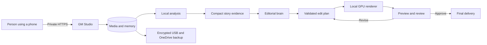
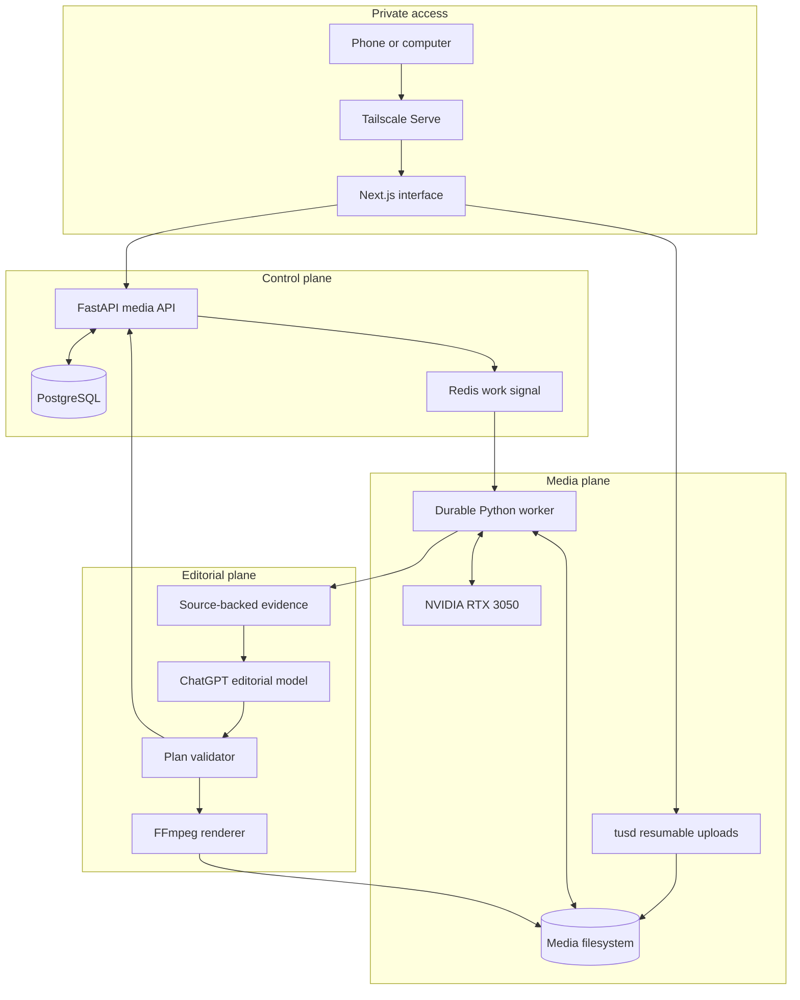
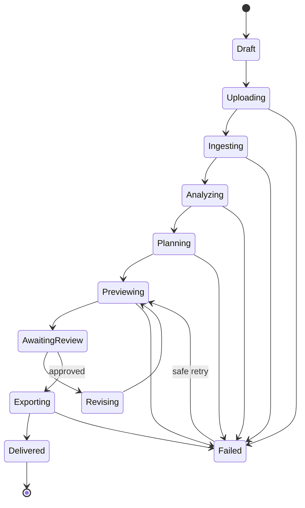
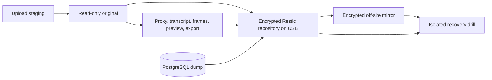
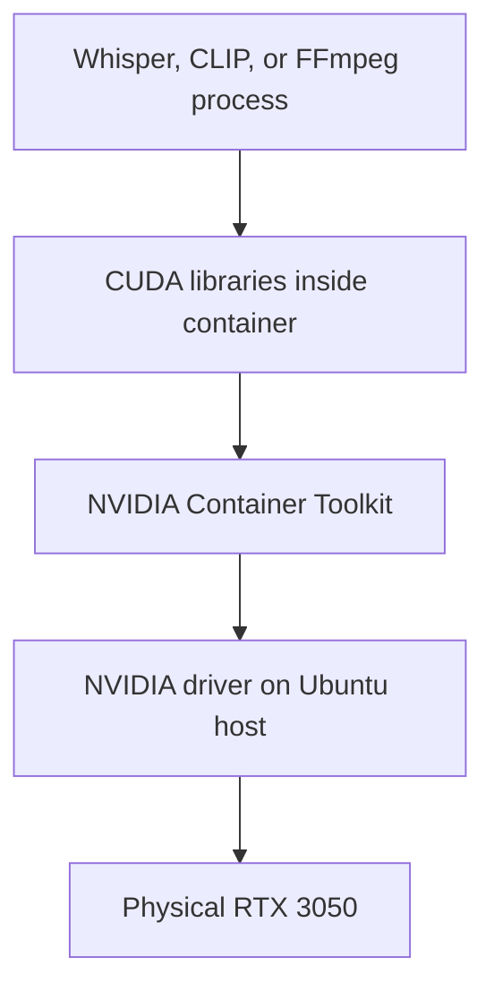
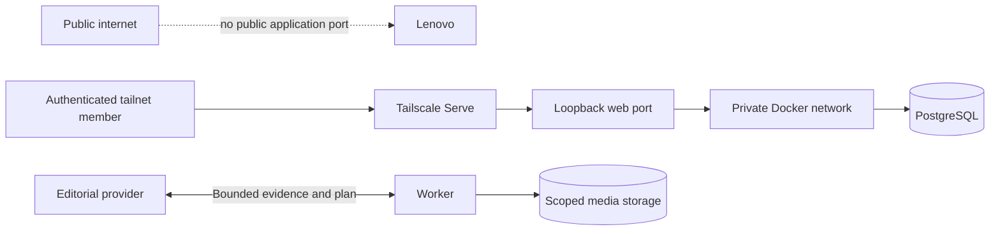

# GM Studio system architecture guide

This guide explains GM Studio twice: first as a simple story that is easy to share, then as a deeper technical walkthrough. It also explains CUDA and how the Lenovo's NVIDIA GPU participates in analysis and rendering.

## The short explanation

GM Studio is a private video-editing appliance running on the Lenovo server. It stores and analyzes source media locally, asks an editorial model to make bounded creative decisions, validates those decisions, and renders the result locally.

The easiest mental model is:

- **Memory:** the media library, transcripts, visual index, metadata, projects, and edit history.
- **Brain:** the editorial model that chooses a story from structured evidence.
- **Hands:** FFmpeg, Whisper, CLIP, and the NVIDIA GPU that inspect and render real media.
- **Safety system:** validation, permissions, immutable originals, provenance, and encrypted backups.



A useful one-sentence description is:

> GM Studio privately understands your footage, gives an AI director a compact map of the useful moments, and then performs the approved edit locally with deterministic media tools.

## What happens to an uploaded video

1. The upload resumes if the phone connection is interrupted.
2. The completed original receives a SHA-256 fingerprint and becomes read-only application data.
3. FFprobe records its format, duration, streams, dimensions, frame rate, and rotation.
4. FFmpeg makes edit-friendly proxies, thumbnails, contact sheets, scene boundaries, and audio measurements.
5. Local Whisper transcribes speech with source timestamps.
6. Local CLIP indexes representative frames so visible subjects can be searched semantically.
7. PostgreSQL connects every fact to the immutable asset and exact source time range.
8. A job attaches references to selected originals without copying them.
9. The editor receives a bounded evidence packet and returns a structured edit decision list.
10. Trusted code validates every asset, time range, effect, and duration.
11. FFmpeg and the NVIDIA GPU render a preview and, after approval, a final package.
12. Job history, model usage, edit provenance, and recovery backups remain available.

## The main system areas



### Private access

Tailscale supplies the encrypted network connection and authenticated identity. The web container listens only on the server's loopback interface. The configured owner can invite active editor or viewer identities that already belong to the tailnet.

### Control plane

FastAPI is the authority for projects, assets, jobs, edit plans, approvals, library metadata, access roles, and downloads. PostgreSQL is the durable source of truth. Redis is a lightweight wake-up signal; losing Redis does not erase the job because the durable state remains in PostgreSQL.

### Media plane

The media filesystem contains originals and separate derived files. The worker claims durable work, performs analysis or rendering, writes results atomically, and updates PostgreSQL. Originals are never overwritten by an edit.

### Editorial plane

The editorial model receives structured evidence and returns JSON matching a strict schema. It does not receive shell access, Docker access, arbitrary filesystem paths, or permission to invent an asset ID. The validator rejects unknown sources, invalid time ranges, unsupported effects, and unsafe plans before FFmpeg sees them.

## Services and responsibilities

| Service | Responsibility |
|---|---|
| `web-agent` | Phone-friendly interface, Tailscale identity enforcement, upload and review flows |
| `api` | Projects, assets, jobs, permissions, plans, approvals, usage, and authorized media delivery |
| `tusd` | Chunked and resumable uploads into staging storage |
| `postgres` | Durable metadata, catalogue, edit history, access roles, provenance, and audit events |
| `redis` | Efficient worker notification and short-lived coordination |
| `worker` | Ingest, transcription, catalogue building, edit planning, rendering, recovery, and packaging |
| `visual-indexer` | Private CLIP image/text embeddings for semantic visual search |
| `media-init` | Prepares the persistent media directory layout and permissions |
| `migrate` | Applies ordered database migrations before the application becomes healthy |

## The job lifecycle



Long operations are durable. A worker records a lease while it is processing. If the container or whole server stops, an expired lease makes the work claimable again. The database, rather than an open browser or model connection, owns progress.

## The evidence sent to the editorial brain

The hosted model does not need the original files. GM Studio assembles an editorial context containing:

- The user's brief, recipe, target duration, platform, aspect ratio, and style.
- Immutable asset IDs and source names.
- Transcript segments with exact timestamps.
- Scene boundaries and duration.
- Visual-quality and audio measurements.
- Locally selected thumbnails or contact sheets when the privacy mode allows them.
- Approved local music facts and beat grids.
- Brand kit and publishing preset.
- Previous plan and requested changes during a revision.

Internal storage paths are stripped before a hosted request. Long material is bounded to a configured context size. Phase 13 improves this further by supplying reusable moment cards and retrieving the strongest evidence before the planning request.

## The edit plan

The edit decision list is the contract between creative reasoning and deterministic rendering. A clip records facts such as:

```json
{
  "asset_id": "registered-uuid",
  "source_in": 12.4,
  "source_out": 16.8,
  "transition": "cut",
  "visual_preset": "punch_in",
  "story_role": "payoff",
  "editorial_intent": "Deliver the answer with restrained emphasis."
}
```

The complete plan also records the recipe, captions, audio preset, music choice, editorial summary, and post copy. Pydantic and additional validators confirm that the source exists, timestamps fit the source, clips do not overlap illegally, duration is bounded, and only supported operations are requested.

The model decides **what** should happen. Trusted code decides **whether it is allowed** and **how FFmpeg implements it**.

## Storage and recovery



Originals and derived files have different lifecycles. Retention may remove reproducible previews and deliveries after their configured age, while the database keeps the plan needed to rebuild them. A database constraint requires retention runs to report zero removed originals. Exact duplicates can share physical disk blocks only after their SHA-256 values and canonical review agree; their database records and historical paths remain distinct.

Restic encrypts the database dump, protected credentials, project configuration, and media. OneDrive contains encrypted repository objects rather than directly playable videos. Recovery tests restore into an isolated directory and validate the result before it is trusted.

# CUDA and the GPU

## What CUDA is

CUDA is NVIDIA's software platform for running general computation on an NVIDIA GPU. A GPU contains many smaller execution units that can process large batches of similar mathematical work in parallel. CUDA lets software use those units for tasks beyond drawing graphics.

In GM Studio, CUDA does not replace the application or the container. It is a path that lets selected programs inside the worker containers send supported work to the physical RTX 3050.



### Host driver

Ubuntu owns the NVIDIA kernel driver. The driver communicates with the physical GPU. Containers do not carry or replace this kernel driver.

### NVIDIA Container Toolkit

Docker normally isolates hardware devices. The NVIDIA Container Toolkit exposes selected GPU devices and matching driver libraries to an authorized container. Compose requests GPU access for the worker and visual indexer.

### CUDA runtime inside the container

The CUDA worker image includes user-space CUDA and cuDNN libraries expected by GPU-aware applications. Pinning these libraries in the image makes the processing environment repeatable.

### Application

Whisper, CLIP, PyTorch, and some FFmpeg operations detect the exposed GPU and submit supported work. Ordinary Python code, PostgreSQL queries, HTTP handling, and most filesystem work remain on the CPU.

## GPU work in GM Studio

The RTX 3050 contains different hardware paths:

| GPU facility | GM Studio use |
|---|---|
| CUDA cores | Parallel numerical operations used by local analysis models |
| Tensor cores | Accelerated lower-precision neural-network matrix operations when supported |
| NVENC | Dedicated hardware video encoding for H.264 delivery and previews |
| NVDEC | Dedicated hardware video decoding when the FFmpeg pipeline supports it |
| VRAM | Holds model weights, tensors, decoded frames, and intermediate GPU data |

These paths are related but not identical. `h264_nvenc` uses the dedicated encoder rather than occupying CUDA cores in the same way as Whisper. A CUDA model can therefore be busy while NVENC performs encoding, although both still share VRAM, power, cooling, memory bandwidth, and scheduling.

## Current GPU workloads

### Faster Whisper

Whisper converts audio into timestamped text. Its neural network uses CUDA and cuDNN through the runtime packaged in the worker image. GPU execution makes transcription much faster than this four-core CPU would normally manage.

### CLIP visual indexing

CLIP converts a source frame and a text search into vectors in the same mathematical space. Similar vectors indicate a likely visual match. The private visual-indexer container runs the pinned CLIP model locally, and PostgreSQL stores the resulting vectors with exact source-frame provenance.

### FFmpeg rendering

FFmpeg builds the edit from validated source ranges, captions, crops, filters, transitions, and audio. The current delivery path prefers `h264_nvenc` for hardware encoding and falls back to `libx264` on the CPU if necessary. Some filter work remains on the CPU because not every FFmpeg filter has a CUDA implementation.

## Why VRAM matters

The RTX 3050 has 4 GB of VRAM. Model weights, inference tensors, frames, and encoder buffers must fit inside it. Running several GPU-heavy jobs simultaneously can cause allocation failure or severe contention even when system RAM is available.

GM Studio therefore limits active work and processes expensive operations conservatively. The suitable pattern for this machine is one major GPU workload at a time, with lightweight web, database, and queue services continuing on the CPU.

## CUDA, NVENC, and containers in plain language

Imagine the GPU is a specialist workshop:

- The **host driver** owns the door and machinery.
- The **container toolkit** gives a named container a secure pass through the door.
- The **CUDA runtime** supplies compatible operating instructions inside that container.
- **Whisper or CLIP** submits mathematical jobs to the workshop.
- **NVENC** is a dedicated video-compression machine in the same workshop.
- The **worker** coordinates the work and stores the results.

The container still runs as a normal isolated Linux process. GPU access is an explicitly granted device capability.

## Observing CPU and GPU activity

Whole-server CPU and memory:

```bash
htop
```

Container CPU and memory:

```bash
sudo docker stats
```

GPU utilization, memory, temperature, power, and active processes:

```bash
nvidia-smi
```

Refresh the GPU view once per second:

```bash
watch -n 1 nvidia-smi
```

Check GPU visibility inside the worker image:

```bash
sudo docker compose exec -T worker python -c "import torch; print(torch.cuda.is_available())"
```

FFmpeg's active encoders can be inspected inside the worker:

```bash
sudo docker compose exec -T worker ffmpeg -hide_banner -encoders
```

## Failure boundaries

- If hosted editorial reasoning is unavailable, existing plans and local deterministic edits remain usable.
- If CUDA model inference fails, the job records an error and can be retried; the original remains unchanged.
- If NVENC fails, supported render paths fall back to CPU `libx264`.
- If a worker stops, PostgreSQL leases allow another worker instance to resume durable work.
- If a browser closes, server-side work continues.
- If the internal disk fails, the encrypted USB and OneDrive repository provide recovery paths.

## Security boundaries



The design combines several boundaries:

- Tailscale authenticates network identities.
- The web layer applies owner, editor, and viewer permissions.
- The API owns state and validates requested operations.
- Containers communicate over a private Docker network.
- Only GPU workers receive GPU device access.
- Only bounded evidence is sent for editorial reasoning.
- Models cannot supply arbitrary shell commands or filesystem paths.
- Originals, plans, and derived outputs retain provenance.
- Backups are encrypted before leaving the server.

## Phase 13 story intelligence

Phase 13 adds a local story-intelligence layer. It turns existing transcripts and scene ranges into reusable, source-timestamped moment cards. A compact local retrieval step chooses relevant and structurally strong evidence for the editor. The job form records the audience, desired understanding, intended feeling, and ending. The edit plan describes each clip's narrative role, such as hook, context, development, payoff, reaction, or ending, plus its editorial intent.

This improves story quality without adding a model call per clip. Analysis is performed once and cached, one bounded editorial request plans a new edit, and exact timeline refinements and delivery variants continue locally without additional model usage. Later Phase 13 work can add locally measured motion, faces, laughter, applause, shot scale, and continuity hints to the same evidence contract.
