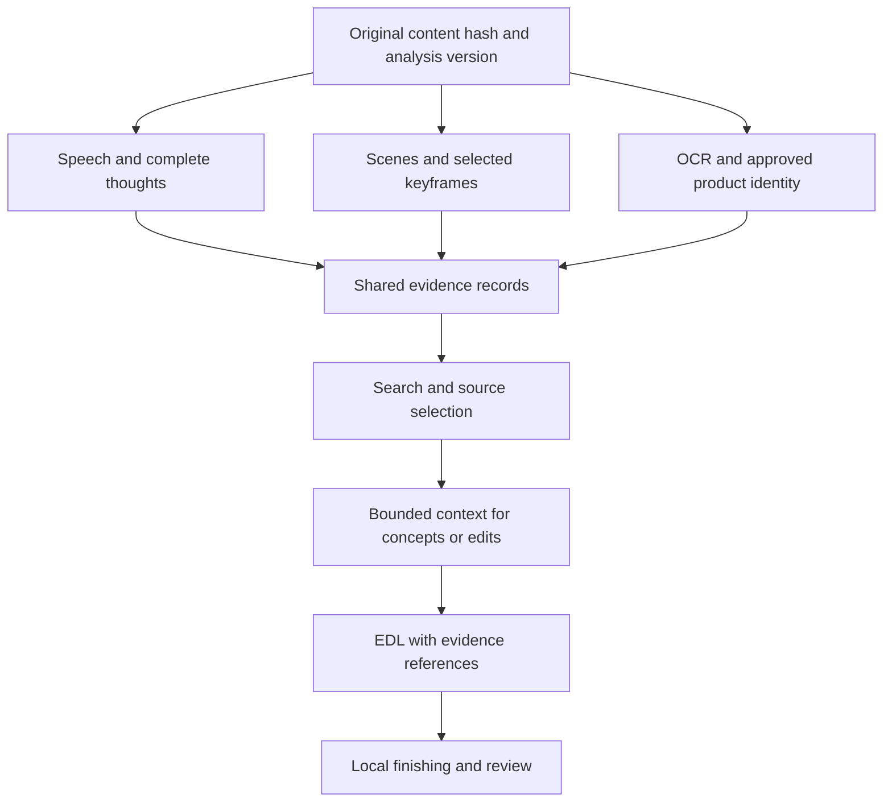
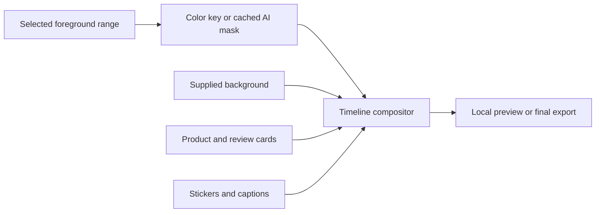

# GM Studio system audit and build roadmap

26 October 2026 · Australia/Brisbane · Planning edition

**Recommendation:** keep the successful source-led editor and deterministic renderer. Improve the evidence they work from, make precise changes easier, and measure quality before adding more model calls. Build a simpler studio around that foundation, then add a reusable compositing system for richer effects and background replacement.

This is a plan, not a claim that the proposed features are implemented. Source review used commit `bf05b2a`. Live inspection covered 17 screens at two viewport sizes. The deployed interface exposes the recent library organization controls; an exact deployed source commit was not independently established.

The companion [agent editing toolkit](agent-editing-toolkit.md), also available as a [PDF](GM-Studio-Agent-Editing-Toolkit.pdf), compares useful CapCut capabilities with our current tools. It expands phases 21–23 with concrete uses, agent decision rules, shared technical foundations and acceptance criteria.

## 1. What the audit established

The existing system already does the difficult part well: it turns real source speech and pictures into a versioned edit, renders locally, supports review and revision, and preserves the original material. Replacing this with a larger autonomous agent would risk the quality and token savings already achieved.

### Evidence and limits

| Inspection | Result | What this establishes |
|---|---|---|
| Live browser, desktop 1440 × 1000 and phone-sized 390 × 844 | 34 navigations across 17 screens; all returned HTTP 200; no uncaught page errors, observed HTTP failures or root horizontal overflow | Current page loading and initial data rendering work at these sizes |
| Read-only library interaction | Photos and B-roll filters changed the visible view | These controls respond without submitting an edit |
| Automated WCAG A/AA checks at phone width | Findings on seven screens, detailed below | Specific accessibility defects; this is not a complete accessibility certification |
| Source inspection | All 18 page route files, form components, context construction, analysis, queues, rendering policy and learning rules reviewed | The intended flows and important implementation limitations |
| Hardware query | NVIDIA GeForce RTX 3050 Laptop GPU, 4096 MiB VRAM | Plan for a shared 4 GB GPU, not a large inference server |
| Production writes and hosted AI | None submitted by this audit | Existing jobs, media, feedback and model allowance were preserved |

Non-GET/HEAD browser requests were blocked during inspection. No upload, render, metadata application, export, deletion, role change or paid generation was exercised. The resumed chat route was source-reviewed; no private chat session was created or resumed. Container/database internals and recovery drills were not rerun. Report-only navigation does not replace end-to-end write-path acceptance.

Private screenshots and detailed browser results remain outside the repository. This report contains no private transcripts, media, account identifiers or deployment addresses. Performance improvements below are hypotheses until measured; no speedup or token-saving percentage is claimed.

The sanitized navigation and accessibility results are recorded in [the audit evidence file](phase-reports/2026-10-26-system-audit.json).

### Highest-priority findings

1. **Library knowledge is fragmented.** Auto-sort can produce useful names, categories and tags, but the normal editor context currently selects display name and video role without selecting library category, tags or notes. Concept discovery has a separate metadata path. More organization does not yet mean every editing entry point receives that knowledge.
2. **Visual similarity is not video understanding.** CLIP helps find similar frames, but the catalogue still describes a scene as “Scene N” and a photo as “Still image.” There is no general persistent OCR, product identity or visual action description in this path. The editor sees bounded pictures rather than watching every frame.
3. **Some local work is repeated unnecessarily.** Whisper is instantiated inside each transcription call. Duplicate original storage is shared, but ingest still performs per-asset analysis. Visual indexing extracts frames before applying its final per-asset cap.
4. **Queue ordering can make interactive work wait.** The worker drains pending ingest and catalogue work before edit work. Existing-library renders can wait behind a large upload batch; the separate CLIP service also shares the GPU without a global memory scheduler.
5. **Learning is currently a cautious rule system.** It aggregates selected feedback tags, not written notes, and scopes preferences by recipe rather than user/brand/reel intent. It does not train model weights or autonomously improve its own code.
6. **Quality checks have an honest but limited scope.** They can identify technical faults. They do not establish a coherent story, correct product attribution, audible backing music relative to speech, readable burned-in captions or good skin tones.
7. **The product has outgrown its navigation.** There are eleven links in one shared navigation and several different custom navigations. Create, concepts, organization, creative assets and settings need a consistent home.
8. **Editing policy sometimes imposes decoration.** An energetic/high-impact talking-head edit of at least 20 seconds requires a transition beat; default repair can add a dip to black. Replace this requirement with editorial guidance and measured coverage of meaningful beats.

## 2. The system in plain language

Think of the server as a librarian, an editor and a production desk.

The **librarian** keeps the originals and prepares transcripts, thumbnails and searchable records. The **editor model** receives selected evidence plus the brief and returns instructions describing which real footage to use. The **production desk** follows those instructions using local video tools. Your review decides whether the result is worth publishing.

The model normally writes an edit decision list, or EDL. It does not generate the final video frames or synthesize the speaker’s voice. Exact re-renders and supported local adjustments can reuse that EDL with zero additional model tokens.

<!-- diagram: current-flow -->

PostgreSQL holds durable records, jobs and leases. Redis wakes the worker; it is not the sole record of work. The Next.js interface talks through the API to the private FastAPI service. Local media volumes retain originals and derivatives. Tailscale protects the current private deployment. Restic and the off-site copy support recovery.

These boundaries are useful. Preserve them while consolidating the user experience.

## 3. Page and form review

All paths below are existing routes. Recommended changes are proposals.

| Current page | Keep | Consolidate or add |
|---|---|---|
| Home `/` | Recent work, clear next actions, studio pulse | Add Resume, Import footage and Find ideas as primary actions; show processing progress and real health warnings without crowding creation |
| New Edit `/jobs/new` | Mixed server media and uploads, privacy choices, saved presets | Use a shared media basket and progressive form; keep essential direction visible, move detailed controls into expandable sections; save recoverable drafts |
| Jobs `/jobs` | Complete history and resumable links | Filters for needs review, processing, delivered and failed; hide verification jobs by default; search original briefs; distinguish archive from source-media Trash |
| Job review `/jobs/[jobId]` | Playback, prompt history, breakdown, local changes, revision, export and feedback | Desktop player plus inspector; phone tabs for Watch/Edit/Feedback; waveform and word-level selection; version compare; explain whether each action uses AI |
| Prompt history `/prompts` | Historical briefs and revision context | Keep a deep link, but make this a Jobs view and a per-job panel rather than another primary destination |
| Media library `/library` | Standalone import, search, roles, categories, collections, names, Trash, auto-sort | Shared picker/detail panel, grid/list toggle, source preview, analysis readiness, reusable product/topic identity and per-range roles; reduce simultaneous bulk actions |
| Duplicate audit `/library/duplicates` | Exact-match review and safe storage reuse | Put under Library health; distinguish hiding a record from reclaiming physical bytes; show what remains referenced |
| Concepts `/concepts` | Existing recorded speech first, saved options, deliberate selection before rendering, blooper mode | Make it Create → From library; show script preview with source playback, inclusion/exclusion reasons, evidence coverage and estimated cost before generation |
| Creative `/creative` | Rights records, music/effects catalogue, auditioning | Library → Music and Effects; add mood/purpose search, favorites, duration/energy filters and contextual recommendations; label every icon button |
| Brand `/settings` | Caption identity and saved recipes | Studio → Brand; label selectors; add approved spellings/product dictionary, caption safe-area previews and reusable style intensity |
| Learning `/learning` | Visible evidence and reversible preferences | Studio → Learning; explain exactly which tags influence edits; expose proposed/active rules, their scope, evidence and rollback |
| Usage `/usage` | Measured requests and tokens across editing and supporting tasks | Studio → Usage; show tokens per accepted reel, cache accounting when provided, initial plan versus revision/repair, and estimated next-action allowance |
| Operations `/operations` | Budgets, concurrency limits, derived-file retention and audit | Combine with System under Studio → System; make active queue priority, wait reason and recovery actions understandable |
| Access `/access` | Server-side access roles and member management | Studio → People; role-appropriate navigation and separate UI editing permission from future media/workspace isolation |
| System `/system` | Backup status, storage and work queues | Merge operational overview with Operations; add CPU/GPU/VRAM, stage timings, last-good build ID and backup restore evidence |
| Welcome `/welcome` | Guided readiness checks | A dismissible first-run checklist with explicit completion; return to dashboard after setup |
| Chat `/s` and `/s/[sessionId]` | Natural-language access to explicit tools | Treat as an optional expert surface until tools match the main UI; explain chat attachments versus imported library assets and the separate gateway path |

### Concrete accessibility findings

Automated checks flagged four rule types across seven inspected screens. Counts describe this live sample and may change with catalogue size.

| Location | Finding | Proposed correction |
|---|---|---|
| Creative | 42 buttons without accessible names | Explicit action and asset names; pressed state for favorites, clear archive/play labels |
| Brand | Two selectors without accessible names | Visible associated labels and keyboard testing |
| Library | 29 row buttons whose accessible names omit visible text | Include the displayed media title in the accessible name; preserve independent selection and detail actions |
| New Edit, Learning, Chat and Job review | One contrast finding on each screen | Adjust the affected small text colors, then recheck all states |

A browser size check is not a physical phone test. Still test software-keyboard resizing, screen readers, upload interruption, browser backgrounding, tap targets, focus return after dialogs and sticky controls covering the last form field.

### Proposed navigation

Use five stable destinations: **Home, Create, Library, Jobs, Studio**. Studio contains Brand, Learning, Usage, People and System. Create offers “Use selected footage” and “Find ideas in my library.” Library contains media, music/effects and library health. Preserve old URLs as redirects or deep links.

The same media basket should work in import, concepts and New Edit. Selection must survive switching tabs, filtering or adding files. Users should see why a source is unavailable, whether analysis is partial, and what will happen after pressing the primary action.

For New Edit, ask first for footage, intended result and publishing destination. Offer a sensible saved style. Expose duration as an approximate goal, not a quota; music, FX, B-roll, caption and model controls remain available under clear sections. The inspected New Edit DOM contains 71 inputs/selects/textareas, including radio groups and file controls. This is a complexity signal, not 71 independent decisions required from the user.

## 4. What context the model actually receives

### Current extraction and use

| Evidence | How it is produced | How it helps | Limit |
|---|---|---|---|
| Technical metadata | ffprobe: streams, dimensions, duration, orientation and color information | Safe decode, crop, duration and HDR handling | Describes the file, not its meaning |
| Speech | Local faster-whisper Small, VAD, word times and confidence | Search phrases, choose dialogue, schedule captions and protect cut boundaries | Recognition errors and timestamp errors remain possible |
| Pictures and scene changes | Thumbnails, contact sheets, FFmpeg scene boundaries | Recognize broad subjects and available coverage | Scene detection is not semantic scene naming |
| Visual search | Local CLIP ViT-B/32 embeddings of sampled source frames | Match a text query to visually similar frames | Similarity is not a verified description or product identity |
| Story moments | Local scores, keyword/position rules, repeated-idea and take-quality hints | Suggest hooks, complete passages and possible repeated takes | Heuristics are suggestions; they do not understand the whole story |
| Bloopers | Transcript markers, restarts and nearby setup/recovery | Find possible outtake material without a new recognition pass | Misses visual gags and laughter absent from the transcript; does not prove an error |
| Direction | Brief, audience, must-include, story goal, tone, ending, style and selected concept | Defines what this particular edit should accomplish | More fields do not help when empty, contradictory or hidden from the relevant flow |
| Personal preferences | Local aggregation of repeated feedback tags | Adds cautious directives to future plans | Written notes are not interpreted; scope is currently recipe-wide |

`build_editor_context` assembles source transcripts, technical facts, selected story moments, direction, brand information and available approved music/effects. Private storage paths and redundant metadata are removed before sending. Word-level source timing remains useful locally even though the public transcript is simplified to segment start/end/text.

The public editor context has a configured **120,000-character** budget. This is a character limit, not a tokenizer-aware guarantee. It first removes repeated scoring detail, then reduces spoken moment hints while retaining full dialogue. If necessary it samples transcript segments across sources and beginning/middle/end, with explicit truncation markers. A large inventory can still exceed the residual base budget and fail.

Hybrid picture coverage depends on recipe and style. High impact packs up to six source thumbnails per image within four talking-head or twelve montage images, sent at low detail. Other styles use up to four/twelve source contact sheets or previews. These are not full-video inspection. Tiny review text, a product revealed later, motion and an exact speaking/non-speaking interval can be missed.

Concept discovery separately caps its source inventory at 60 unique ready sources and 36,000 characters, with balanced groups and bounded speech evidence. Auto-sort handles up to 24 selected files with a separate proposal/apply flow. These bounds control requests, but the three flows should share an evidence representation and explain which evidence was omitted.

### Is this the best approach?

The **architecture is appropriate**: analyze locally once, retrieve evidence, let the capable editor choose, then render deterministically. The opportunity is to make “analyze once” and “retrieve useful evidence” more complete and consistent.

A product name in a display label is useful, but a model also needs to know which exact seconds show that product, what was said about it, and whether the image contains readable proof. Sending every frame or installing a much larger local language model would be an expensive way to fill this gap on a 4 GB card.

## 5. A better shared media memory

Build one versioned evidence layer used by search, auto-sort, concepts, editing and quality review. Keep originals immutable and editable metadata separate.

<!-- diagram: evidence-flow -->

### Proposed evidence records

Every record needs a source hash, analysis version, exact time range where applicable, method/model version, confidence, and a reference to supporting words or frames. Distinguish **measured facts**, **model suggestions** and **user-confirmed facts**. An auto-sort label must not become unquestionable truth.

Store these useful additions:

- **Complete spoken thoughts:** preserve sentences, connected clauses, pronoun antecedents, source word alignment and alternate takes. Keep the original ASR separate from caption corrections and approved terminology.
- **Product/topic identity:** a user-confirmed dictionary and aliases, with evidence-backed links to the ranges that mention or show each item. Review claims must stay attached to their original product and speaker.
- **Readable text:** run local OCR once on review screenshots, documents and selected product frames; retain bounding boxes, confidence and original text. Do not infer tiny text from a low-detail thumbnail.
- **Visual roles by range:** talking presenter, product detail, hands demonstration, review card, location, reaction or unknown. A single file may contain both talking footage and suitable B-roll.
- **Take and sound events:** speech, music, silence, likely laughter, restart and production chatter as separate evidence. A gap between recognized words is not necessarily silence.
- **Useful composition:** subject bounds, product bounds, shot scale, camera movement and likely crop safety. Add tracking only when a selected shot needs it.

Start with local metadata, OCR, word grouping, verified labels and better frame selection. If semantic descriptions still have clear value, offer an opt-in, bounded enrichment pass over representative frames and reuse the result across edits. Compare a lightweight local candidate against occasional hosted enrichment on the real machine; do not assume a local VLM is cheap or accurate enough. No automatic whole-library hosted reanalysis.

### Retrieval and context construction

1. Filter to permitted, active, available sources and the selected collection. Honor explicit source restrictions and locked choices.
2. Retrieve candidates with exact words, product/topic aliases, complete-thought groups and visual similarity. Group exact duplicates and alternate takes without collapsing genuinely different scenes.
3. Diversify across relevant products, story roles and source groups. Preserve setups, endings and requested phrases. Do not force every uploaded file into one reel.
4. Add exact matching frames and readable OCR for selected candidates. A frame selected for the spoken topic is usually more useful than another generic opening thumbnail.
5. Assemble one stable, bounded packet with source IDs, cited ranges, necessary neighbors, known omissions and contradictory evidence. The model can explicitly say a broader story is unsupported.
6. Validate every returned asset and range against the full local inventory. Preserve referents and source facts even when moving passages.

For very large libraries, retrieve locally first. An optional bounded tool can fetch a missing neighboring passage or inspect a specific source frame. Give it an explicit call/token ceiling and stop when sufficient evidence exists. Keep the normal one-plan-request path; do not make a multi-agent investigation the default for every reel.

Avoid overcompression. A short packet that drops the setup or product introduction can be cheaper and produce a worse story. Evaluate source coverage and accepted-edit quality alongside tokens.

## 6. Compute and token efficiency

### What CUDA does here

CUDA lets supported programs run parallel numerical work on NVIDIA hardware. Whisper inference, CLIP embeddings and a future segmentation model can use it. GPU memory is shared by those models, their intermediate tensors and video workloads.

NVENC is the GPU’s dedicated video encoding hardware. Using `h264_nvenc` does **not** mean every FFmpeg filter runs on CUDA: decode, tone mapping, subtitles, overlays and memory transfers may still consume CPU time. NVIDIA documents NVENC as a hardware encoder accepting frames and producing encoded video. [NVIDIA NVENC guide](https://docs.nvidia.com/video-technologies/video-codec-sdk/13.0/nvenc-video-encoder-api-prog-guide/index.html)

### Verified implementation opportunities

| Current behavior | Proposed improvement | Gate before enabling |
|---|---|---|
| Whisper model construction inside each transcription | Reuse one worker-local model while warm; unload or switch device under memory pressure | Same transcript/cut quality; measured cold/warm latency and peak VRAM |
| Duplicate original bytes shared, but analysis is per asset | Cache immutable analysis by content hash + configuration/model version, with per-asset reference manifests | No cross-identity paths, stale versions or lost ownership; aliases preserve original references |
| Visual frame extraction precedes the final 120-frame cap | Select bounded timestamps before decode; batch extraction and reuse thumbnails | Same or better query relevance and temporal coverage with fewer process starts |
| Visual searches fetch all eligible embeddings and score in Python | Cache normalized query embeddings; benchmark SQL/vector-index retrieval as the library grows | Filter/permission correctness and search-recall comparison; no vector database migration just for a small library |
| Separate CLIP and transcription processes share GPU | One resource coordinator with memory reservations, priority lanes and bounded background batches | No out-of-memory event or starvation in mixed import/search/render tests |
| Worker drains ingest before edits | Fair scheduling: finish required source analysis, then service interactive work between background tasks | Existing ready-source previews start promptly during large imports; durable leases still recover |
| Several FFmpeg passes over the same source | Profile per-stage work; combine compatible measurements and cache stable results | Equivalent measurements, correct HDR treatment and bounded memory |
| Four/six-thumbnail sheets can obscure fine detail | Fetch fewer, relevant, higher-value evidence crops when needed | OCR/identity accuracy improves without indiscriminate extra images |

The CLIP service currently loads its model once and uses inference mode, which is good. It does not explicitly convert the model to half precision. Benchmark FP16 or a CPU/ONNX alternative on a holdout before changing it; lower memory alone is not proof of unchanged search quality. faster-whisper supports quantized inference and batching, but batch size, beam size and device choice must be measured against the actual source material. [faster-whisper project](https://github.com/SYSTRAN/faster-whisper)

### A practical work policy

Use separate logical lanes for interactive preview/export, required ingest, background enrichment and maintenance. This does not require four GPU workers. On this machine, begin with one heavy CUDA inference task at a time, bounded decode/encode work and reserved headroom. Allow CPU metadata and lightweight I/O to proceed when safe. A running GPU operation may need to finish before yielding; do not promise instantaneous preemption.

Record queue wait and execution separately. Display “Waiting for transcription” or “Indexing in background,” not an indefinite spinner. Pause optional indexing when an interactive render or essential analysis needs resources. Cache masks, keyframes, OCR and speech by version so future edits reuse them.

### Hosted request policy

- Preserve the current successful model and reasoning defaults until a representative comparison demonstrates equal or better edits.
- Measure instruction, transcript, metadata, picture, output and repair contributions separately. Characters alone are an imperfect token budget.
- Keep stable instructions and schemas stable; send variable job evidence after them where supported. OpenAI documents prefix-dependent caching and cautions that a shared prefix does not always produce cache reuse. Measure returned cached usage for the actual provider/model. Do not assume standard API cache pricing or flags apply to the connected ChatGPT-plan transport. [OpenAI prompt caching](https://developers.openai.com/api/docs/guides/prompt-caching)
- Rank and cap FX/music candidates before sending them. A selected track needs its creative data, not the whole music catalogue; rights enforcement remains local.
- Use exact local operations for known timing, gain, caption, crop and cue changes. Keep invalid-schema repair bounded and separately visible in usage.
- Optional AI critique should inspect a compact script and a few relevant moments only when justified. Do not repeatedly upload the whole rendered reel and regenerate it until an AI gives itself a high score.

No hardware purchase or new cloud service is necessary to start these improvements. Consider a larger GPU only after stage timing and peak-memory evidence identify a remaining bottleneck that affects actual use.

## 7. Editing quality and tools

### Story and dialogue first

Make the planned story inspectable before rendering: hook, essential context, new information, proof/payoff and a clean ending, each linked to recorded words or pictures. Show why sources were excluded. A source-story checklist must remain visibly distinct from a judgement of the finished edit.

Use word-level handles and complete-thought boundaries. Add a transcript editor where the user can select an actual pause, remove a restart, choose another take and listen to the join. Keep a brief reaction when it earns its place. An ad and a blooper reel need different take-selection and pause policies.

Protect product attribution across related footage. “This cream” followed by a different product’s benefit is a semantic error even if every source range is valid. Store approved product aliases and source claims; preserve uncertainty when visual evidence cannot distinguish similar containers.

Remove mechanical requirements for a transition or a fixed number of effects. High impact should offer opportunities around every 2–3 seconds, with intentional holds and complete dialogue taking precedence. A relevant B-roll reveal, framing change, caption emphasis or sound accent can satisfy that purpose; a dip to black is not always appropriate.

### Tool backlog ordered by likely value

| Tool or capability | User benefit | Incremental compute | Priority |
|---|---|---|---|
| Word/pause selection, split/trim/reorder and before/after playback | Precise fixes without asking the model repeatedly | Local preview/render | First |
| Per-clip gain, music/voice/SFX audition and visible ducking | Fix quiet words and inaudible or intrusive music | Local audio measurement/mixing | First |
| Caption text/timing per cue, approved dictionary and per-range placement | Correct names, preserve sync and avoid product/face/UI overlap | Local text/layout/render | First |
| Evidence-backed product/review B-roll with crop/contain controls | Better proof and fewer wrong cutaways | Cached retrieval plus local composition | First |
| Version comparison and scoped revision with protected elements | Preserve a great story while changing one fault | Zero AI for precise operations; bounded AI for story changes | First |
| Focus-aware crop/zoom, anchor points and limited subject tracking | Keep presenter, hands and product visible | Tracking only selected ranges | Next |
| Better transitions, audio J/L cuts and short audio crossfades | Smoother continuity without cut-off words or black dips | Local render; requires timeline overlap rules | Next |
| SFX placement on a recorded reveal, keyword or reaction | A ding, pop, boing or whoosh supports a real beat | Local render; small planning descriptors | Next |
| Kinetic caption emphasis and product callouts | Highlight a number, term or benefit without covering the subject | Local typography and layout | Next |
| Beat-aware B-roll and selective speed changes | More energy in demonstrations and montage | Local render; preserve original speech speed by default | Next |
| Picture-in-picture, split screen and reusable review/product cards | Explain, compare and show proof clearly | Local compositor | Next |
| Green-screen key and selective background removal | Presenter over a real supplied scene, demonstration or review | Keying is lighter; AI masks need separate benchmark | After compositor |
| Stabilization, selective denoise and exposure matching | Improve genuinely poor source shots | Optional per-shot processing; can be expensive | Later, measured |
| Text behind subject, tracked masks and more elaborate motion graphics | Distinctive finishing for selected moments | More mask/tracking/render work | Later |

These tools should produce structured, validated edits, not arbitrary model-written FFmpeg commands. Add schema versions, deterministic rendering, recorded provenance and a fallback for unsupported hardware. Keep the renderer modular so timing changes update subtitles, B-roll, effects, masks and audio together.

Music and effect selection should be explainable and easy to audition. Keep the curated starter catalogue, rights records and attribution. Add semantic tags for mood, intensity and purpose, plus frequency/repetition limits. Meme-heavy enables stronger choices; it should not force a meme into an ordinary product explanation. Preview catalogue growth needs filters and candidate ranking rather than a larger prompt.

## 8. Green screen and a reusable compositor

There are two different features people call “green screen.” Both are possible, but their costs and failure modes differ.

**A real green background:** key a selected color, adjust similarity and edge softness, suppress green spill, then place the remaining subject over a supplied image/video. FFmpeg provides chromakey, despill and overlay filters. This is a sensible first experiment, with no hosted model call. Verify filters in the pinned worker build before promising availability. Green products, clothing, reflections and uneven lighting can be removed accidentally. [FFmpeg filters](https://ffmpeg.org/ffmpeg-filters.html#chromakey)

**An ordinary room background:** estimate a foreground mask using a segmentation or matting model, then composite it. MediaPipe provides person/background and other segmentation models for images and decoded video frames. It is a candidate for a local prototype, not a guarantee of clean hair, moving fingers or transparent product bottles. [MediaPipe segmentation guide](https://developers.google.com/edge/mediapipe/solutions/vision/image_segmenter)

Benchmark a short set of selected shots at preview resolution, including curly hair, hands holding products, rapid movement and difficult backgrounds. Check temporal edge flicker and whether the product remains visible. Compare CPU and GPU options. Cache masks by source hash, source range, model/settings and resolution; lift quality for final export only after approval.

Robust Video Matting is another technical reference, but its repository declares GPL-3.0. Review code and model-weight terms before choosing any implementation for distribution; do not casually bundle it into the current product. [Robust Video Matting repository](https://github.com/PeterL1n/RobustVideoMatting)

<!-- diagram: compositor -->

### Compositor requirements

Use a common timeline of layers with source ranges, placement, scale, fit mode, opacity, masks and stacking order. Preserve real alpha channels. Keep source image backgrounds unless explicitly removed; a checkerboard baked into an image is still image content. Use one color-management contract for all layers, including HDR source conversion before SDR composition.

Captions should normally sit above visual layers, with safe-area guides and optional per-range positions. New transitions require correct overlap accounting for picture, speech, captions and effects. Provide edge/mask preview, feather and spill controls, plus an instant original-picture fallback. Track background licensing and preserve audio synchronization. The first release can offer fixed masks/keying and simple placement; full multi-track desktop-editor complexity can wait.

## 9. A measurable improvement loop

The useful recursive loop is **evidence → candidate change → evaluation → promotion → observation → rollback if needed**. It must improve a measured editing policy or tool, rather than blindly trust another AI’s opinion.

### Start with what feedback can teach

Keep ratings and tags, and add optional timestamped annotations such as “pause from here to here,” “wrong product picture,” “music disappears” or “this line is the payoff.” Link them to the exact EDL and renderer/prompt/evidence versions.

Written notes should be reviewable proposed lessons. A scheduled or explicitly requested bounded analysis can group recurring notes into candidate rules once, instead of resending all notes on every edit. Show the supporting examples and let a rule be accepted, rejected or scoped. Do not silently turn one complaint into a global preference.

Make preference strength explicit. For example, the current “Effects worked” tag maps to a directive to keep effects sparse and purposeful; it cannot express “I liked these effects and want more.” Separate successful timing from desired intensity instead of inferring both from one positive tag.

Separate user/workspace, brand, recipe, reel type and style scopes. A preference for short pauses in ads must not remove the setup from bloopers. Current tag rules can remain the fallback while this evolves. No fine-tuning is required initially.

### Evaluation set and promotion

Build a private, consented fixture set of roughly 20–30 representative tasks. Include one and many sources, related products, true B-roll, talking-only footage, reviews, HDR, poor speech, bloopers, ambiguous briefs and missing material. Include examples the user already considers excellent. Keep a held-out portion that is not used to write the candidate rules.

Compare candidate and current behavior on the same sources, settings and brief. Blind human preference is the primary story-quality signal. Local checks cover technical integrity; optional model judging can help triage, but must not be the sole promotion authority. Track factual/product mismatches separately from subjective style preferences.

Require no new critical technical/factual failures and no material decline in human story preference. Use paired results, show sample size and uncertainty, and avoid declaring statistical confidence from a handful of edits. Promote one versioned policy at a time, record why, and retain rollback. Start offline; any production experiment should be opt-in and small.

### Quality checks worth extending

The current review inspects up to 61 seconds of rendered media with a bounded processing budget and preserves successful output if inspection is unavailable. Keep that behavior. Extend it with source-versus-output checks for audio balance, repeated phrases, selected picture identity, caption fit and known HDR fixtures. A tagged BT.709 output can still look wrong; a selected music track can still be inaudible.

Automatic repairs should initially cover only objectively verified faults, such as an invalid cue range or a known layout overflow. A suspected long pause, noisy reaction or weak story should produce a suggestion with playback and an explicit local action. Preserve the original version and make retries idempotent. Bound repair attempts; never create an endless render/critique loop.

## 10. Proposed build phases

Existing Phase 17A is the report-only quality layer and Phase 18 is High impact finishing. The following proposed phases extend those capabilities. They do not mark older live acceptance gates complete. Phase 17’s remaining repair/evaluation ambitions are incorporated into Phase 24 below.

| Phase | Deliverable | Complexity | Dependencies | Exit evidence |
|---|---|---|---|---|
| **19 — Measurement and reliable work scheduling** | Stage/cost telemetry, build ID, fair queues, bounded frame selection, safe analysis reuse and targeted accessibility fixes | Medium | Existing leases and immutable hashes | Mixed import/search/render soak; bounded frame extraction; duplicate reuse; no new AI calls for cached/local work; accessibility regressions fixed |
| **20 — Shared evidence and source understanding** | Consistent metadata contract, product dictionary, OCR, complete-thought records, range roles, retrieval coverage | Large | 19 instrumentation | Same evidence reaches search/concepts/editor; review text and product fixtures pass; omissions visible; token/quality comparison |
| **21 — One studio and precise editing** | Consistent navigation, shared basket, progressive forms, player/inspector, word/pause/audio/caption controls, version compare | Large | 20 evidence contract; can prototype shell alongside 19 | Desktop/phone task completion; precise changes preserve unrelated content; uploads and selections survive navigation |
| **22 — Purposeful finishing** | Evidence-based cadence, focus framing, better audio joins/transitions, cue-level captions/FX, visual audition | Medium–large | 20 and 21 | No forced black dip; no extra default planner call; measured speech/music balance; timing remains aligned after trims |
| **23 — Layered composition and background effects** | Common compositor, PiP/split screen/review cards, real green-screen key; gated AI-mask prototype | Large | 22 timeline semantics; 19 GPU scheduling | Alpha/HDR/edge/motion fixtures; preview and final match; cached mask reuse; acceptable real-machine memory/latency |
| **24 — Evaluated learning and bounded repairs** | Timestamped feedback, scoped proposed rules, holdout tests, candidate promotion/rollback, optional focused critique | Large | 19–22 versioned evidence and telemetry | Candidate beats or matches baseline on quality with stated costs; no uncontrolled repair loops; written lessons auditable |
| **25 — Pilot readiness** | Real-user tasks, onboarding consolidation, permissions/isolation tests, recovery and support diagnostics | Medium | Core preceding gates; effects can remain optional | Representative users complete import→idea→edit→revision→export without developer guidance; recovery and authorization tests pass |

### Recommended next sprint

Start Phase 19 and the contract work for Phase 20. Fix the labelled accessibility issues, expose the deployed build ID, capture timing/token baselines, bound frame selection before extraction, and schedule ready-source edits between background work. Carry category/tags/notes into a compact shared context contract. Prototype the unified shell and precise pause controls as the first Phase 21 slice.

Do not change the default editor model, reanalyze the whole library, or enable automatic AI critique during that sprint. First prove that the existing excellent edits remain excellent. Then add OCR/product identity and targeted retrieval, followed by the more visual tools.

These can be delivered in one sustained build effort with internal checkpoints. Avoid one unmeasured deployment that changes retrieval, model, timeline semantics, color pipeline and learning policy simultaneously; failures would be hard to attribute.

## 11. Acceptance and efficiency scorecard

Capture a baseline before choosing numeric improvement targets. Report median and slow-case results by task class and source duration; keep queue wait separate from processing.

| Dimension | Measure | Acceptance direction |
|---|---|---|
| Story | Blind preference, complete-thought preservation, correct referents/payoff | At least preserve the current strong baseline |
| Source accuracy | Invalid asset/range, wrong product/claim, false blooper | Zero critical errors in the fixed regression set |
| Experience | Task completion, extra clicks, failed submissions, preserved drafts | Fewer confused/repeated actions; no silent submission |
| Context | Pictured/omitted sources, retrieved passage recall, OCR confidence | Useful evidence improves; omissions stay explicit |
| Hosted usage | Input/output/cached/reasoning tokens and call count per accepted reel | Reduce waste without buying a quality regression |
| Local compute | Queue wait, stage seconds per source minute, peak VRAM/RAM, process starts | Measure improvement in actual bottlenecks |
| Reuse | Hash/version cache hits for analysis, frames, OCR and masks | Reusing unchanged content avoids repeating analysis |
| Output | Speech boundaries, caption fit/sync, music audibility, natural color | Real playback fixtures pass, not only valid metadata |
| Reliability | Retries, lease recovery, duplicate submissions and restore evidence | Bounded recoverable work and preserved originals |

### Testing layers

1. Fast unit tests for parsing, timing, policy and validation; real local render fixtures for picture/audio changes.
2. Real PostgreSQL migration and query tests in CI. The recent JSONB music-query defect demonstrates why mocked database calls alone are insufficient.
3. Browser tasks covering defaults, empty states, loading, partial analysis, stale suggestions, errors and recovery. Include keyboard/accessibility checks and phone-sized layouts.
4. An isolated write-path acceptance environment: import mixed media, classify, discover concepts, make a preview, apply one precise revision, approve and download. Check role boundaries and idempotent retries.
5. A separately authorized render/model lane for selected golden tasks with usage accounting. Avoid using routine production history as a dumping ground for verification jobs.
6. Physical phone and real-user testing, followed by backup/restore and reboot drills when deployment changes justify them.

Do not call the entire application verified because every route returns 200 or a unit suite passes. Each release needs both technical checks and representative playback review.

## 12. Consumer-product considerations

Keep the private appliance model while learning from pilot users. Before inviting unrelated customers, define workspace boundaries for originals, search vectors, metadata, concepts, feedback, derived files and backups. Access roles alone do not establish isolated tenants. Add permission tests at every retrieval and download boundary.

Make processing/privacy choices understandable, define retention and recovery behavior, preserve music/effect licences and explain export compatibility. Add a small downloadable diagnostic bundle containing versions and sanitized timings, never credentials or private media by default. Support clear cancellation, job recovery and storage-pressure behavior.

Social platform guides should be versioned visual aids with adjustable caption positions, not an eternal promise that a specific pixel region is safe in every app. Export remains a user-reviewed step. Any future publishing integration needs its own deliberate authentication and approval design.

## 13. Source evidence map

References identify the inspected implementation at `bf05b2a`; line numbers can move as the plan is built.

| Finding | Repository evidence |
|---|---|
| Navigation and separate page shells | `apps/web/app/_components/studio-nav.tsx:4`, `apps/web/app/layout.tsx:35`, page components |
| Library categories and reviewed proposals | `services/core/app/library_organization.py`, `apps/web/app/_components/library-auto-sort.tsx`, migration 028 |
| Normal editor metadata omission | `services/core/app/editor_context.py:60` and asset assembly near line 125 |
| Character compaction and image policy | `services/core/app/editor_provider.py:198`, `:358`, `:572`; `editor_visual_context.py:30` |
| Concept bounds and balanced selection | `services/core/app/concept_inventory.py:13`, `:39`, `:85` |
| Speech and repeated analysis | `services/core/app/media_analysis.py:597`, `:657`; `worker.py:255` |
| Frame extraction before cap | `services/core/app/visual_index.py:199` |
| Full embedding candidate scan and query embedding | `services/core/app/projects.py:499`, `:511`; `visual_service.py:43` |
| Generic scene/photo catalogue text | `services/core/app/content_catalog.py:27` |
| Heuristic story, take and blooper hints | `story_intelligence.py:68`, `:322`; `take_quality.py`; `blooper_detection.py` |
| Queue ordering | `services/core/app/worker.py`, `main` loop near file end |
| Tag-only, recipe-wide learning | `services/core/app/learning.py:182` |
| Technical quality review limits | `services/core/app/quality_review.py:17`, `:65` |
| Required transition and default repair | `services/core/app/edit_plan.py:618`, `:911` |
| Chat tool parity gaps | `agent/tools/request_revision.ts:17`, `agent/tools/search_library.ts:12`, `agent/agent.ts` |

Primary technical references were checked during the audit: [FFmpeg filters](https://ffmpeg.org/ffmpeg-filters.html), [NVIDIA NVENC](https://docs.nvidia.com/video-technologies/video-codec-sdk/13.0/nvenc-video-encoder-api-prog-guide/index.html), [faster-whisper](https://github.com/SYSTRAN/faster-whisper), [OpenAI prompt caching](https://developers.openai.com/api/docs/guides/prompt-caching), [MediaPipe segmentation](https://developers.google.com/edge/mediapipe/solutions/vision/image_segmenter), and [Robust Video Matting](https://github.com/PeterL1n/RobustVideoMatting). Product recommendations are engineering conclusions from these capabilities and the inspected application; vendor benchmarks are not measurements of this server.
